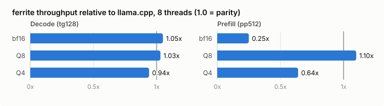
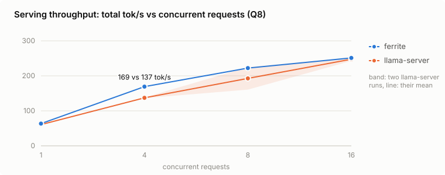
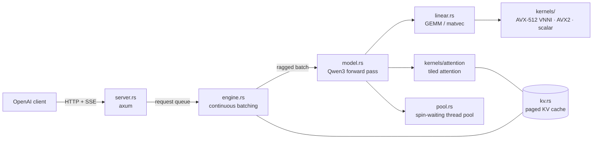

# ferrite

[](https://github.com/EmiRZx/ferrite/actions/workflows/ci.yml)
[](LICENSE)

**A CPU inference engine for LLMs, written from scratch in Rust.** There is no ML
framework underneath. The tokenizer, transformer, quantization formats, SIMD kernels,
thread pool, paged KV cache and an OpenAI-compatible server are all in this repository,
and every layer is checked against Hugging Face `transformers`.

<p align="center">
  
</p>

## Highlights

- **On par with llama.cpp** on the same laptop CPU (Ryzen 9 7940HS), same checkpoint
  and same quantization. Decode 1.03× (Q8), Q8 prefill 1.10×, serving throughput equal
  at 16 concurrent requests and 23% higher at 4. Its Q4 is more accurate (12% lower KL
  divergence). It still trails on bf16 and Q4 prefill, and the reasons are documented.
  [Full comparison](docs/llama-cpp-comparison.md).
- **Hand-written AVX-512 VNNI kernels** with runtime CPU dispatch (AVX2 and scalar
  fallbacks): a register-tiled int8 GEMM microkernel, FlashAttention-style tiled
  attention, and Q8/Q4 weights with f16 block scales.
- **The serving features of a real inference server**: OpenAI-compatible API with SSE
  streaming, continuous batching with chunked prefill, and a paged KV cache
  (PagedAttention-style) with recompute preemption.
- **Correctness first**: logits match `transformers` to 5e-5, including over long
  contexts. WikiText-2 perplexity is identical to four digits. 36 tests run in CI.
- **Every optimization is measured**: decode went from 13 to 102 tok/s and prefill from
  60 to 471 tok/s. The dead ends are written up too.

<picture>
  <source media="(prefers-color-scheme: dark)" srcset="docs/assets/vs-llamacpp-dark.svg">
  
</picture>

<picture>
  <source media="(prefers-color-scheme: dark)" srcset="docs/assets/serving-dark.svg">
  
</picture>

## Architecture



A request is tokenized and queued. Every engine step runs **one** forward pass over a
ragged batch: the next token of every running request plus prompt chunks of new ones.
The matmuls read each weight once for the whole batch, and attention reads each
request's own KV pages. Everything below the server is synchronous Rust on a custom
thread pool. The async runtime only moves bytes.

## Quick start

```sh
# download the model (≈1.5 GB)
mkdir -p models/qwen3-0.6b && cd models/qwen3-0.6b
for f in config.json tokenizer.json model.safetensors; do
  curl -LO https://huggingface.co/Qwen/Qwen3-0.6B/resolve/main/$f
done
cd ../..

cargo run --release -- run "Explain Rust ownership in two sentences."
cargo run --release -- run --think "How many r's are in strawberry?"
cargo run --release -- -d q4 bench --prompt-len 128 --gen-len 128

# quality: perplexity on WikiText-2, KL divergence against the f32 model
uv run scripts/fetch_wikitext.py
cargo run --release -- -d q4 eval models/wikitext-2-test.txt --baseline f32

# kernel micro-benchmarks
cargo run --release --example kernels
```

## Serving

`ferrite serve` exposes an OpenAI-compatible API, so existing clients and tools work
unchanged:

```sh
cargo run --release -- -d q8 serve --addr 127.0.0.1:8080 --max-batch 8 --kv-tokens 8192

curl http://127.0.0.1:8080/v1/chat/completions -H 'content-type: application/json' -d '{
  "messages": [{"role": "user", "content": "What is the capital of France? One word."}],
  "temperature": 0
}'
# {"choices":[{"finish_reason":"stop","index":0,"message":{"content":"Paris.","role":"assistant"}}], ...}

uv run scripts/chat_client.py "Explain what a KV cache is."   # official `openai` client, streaming
```

Supported: `POST /v1/chat/completions` with `stream` (SSE) and
`stream_options.include_usage`, `max_tokens` / `max_completion_tokens`, `temperature`,
`top_p`, `top_k`, `seed`, `stop`, text content parts, and the vLLM extensions
`chat_template_kwargs.enable_thinking` (Qwen3's reasoning mode) and `ignore_eos`. Also
`GET /v1/models` and `GET /health`. Errors use OpenAI's `{"error": {...}}` format, and a
client that disconnects stops its generation.

### Continuous batching

Requests are not served one after another. Every engine step is a single forward
pass over a *ragged batch*: the next token of every running request plus up to 64
prompt tokens of requests still in prefill (vLLM-style chunked prefill). Requests join
and leave between steps. Decode is memory-bound, and the matmuls read each weight
once for the whole batch, so serving 8 requests costs far less than 8 times serving one.

`uv run scripts/load_test.py` (streaming requests of 128 tokens with the official
OpenAI client, `--max-batch 16`):

| concurrent requests | total tok/s | per-request tok/s | time to first token (p50) |
|---:|---:|---:|---:|
| 1 | 71 | 72.5 | 50 ms |
| 2 | 124 | 64.2 | 76 ms |
| 4 | 190 | 49.6 | 156 ms |
| 8 | 244 | 32.2 | 234 ms |
| 16 | 267 | 17.5 | 308 ms |

Total throughput grows 3.8×. It stops scaling where the step becomes compute-bound,
not memory-bound. `examples/kernels` shows the crossover on the LM head (Q8, weights
streamed from DRAM):

| tokens per step | 1 | 2 | 4 | 8 | 16 | 64 |
|---|---:|---:|---:|---:|---:|---:|
| time | 3.2 ms | 3.3 ms | 4.2 ms | 6.1 ms | 10.5 ms | 34.9 ms |
| bound by | memory (56 GB/s) | memory | both | both | compute (238 GMAC/s) | compute (285 GMAC/s) |

The second token in a step is almost free, and by 16 the int8 GEMM kernel's arithmetic
throughput is the limit. Software-prefetching the next weight tile did not help, which
confirms this. Making the small-batch int8 kernel cheaper per MAC is the next lever.

### Paged KV cache

The KV cache is one pool of 32-position pages shared by all requests (as in vLLM's
PagedAttention, `src/kv.rs`). Each sequence keeps a page table, and the attention kernel
reads keys and values tile by tile through it. A page is exactly one attention tile, so
the paging is free. Requests of any length share memory without fragmentation, and
finished requests return their pages at once.

The scheduler (`src/engine.rs`) admits a waiting request when there is a free slot and
enough pages for its tokens plus one spare page per running request. If the pool runs
out anyway, the most recently admitted request is **preempted**: its pages are freed and
it goes back to the front of the queue. When readmitted, its prompt and the tokens it
already generated are recomputed in one prefill (vLLM's recompute strategy), and its
sampler state is kept, so the client never sees a gap or a repeat.

Tests pin all of this down. A ragged batch gives the same logits as running each
sequence alone. Concurrent greedy requests produce exactly the text they produce alone.
A deliberately undersized KV cache that forces preemptions changes nothing in the output.

Options: `-d/--dtype f32|bf16|q8|q4` (default `q8`), `--threads N` (default: physical
cores), `--max-seq N` (context window), `FERRITE_ISA=scalar|avx2|avx512` to force a
kernel set, `FERRITE_PROFILE=1` to print where `bench` spends its time (matmul /
quantize / attention / element-wise). `bench --batch N` decodes N sequences in lockstep,
as the server does.

## Results

Machine: AMD Ryzen 9 7940HS (Zen 4, 8C/16T, AVX-512 + VNNI), 16 GB DDR5-5600 (measured
streaming read: ~50 GB/s), Windows 11. Greedy decoding, 8 threads.

| weights | size | prefill tok/s | decode tok/s | weight bandwidth | WikiText-2 ppl | KL vs f32 | top-1 agreement |
|---|---:|---:|---:|---:|---:|---:|---:|
| f32 | 2274 MiB | 194 | 21.0 | 50.1 GB/s | 28.10 | – | – |
| bf16 | 1137 MiB | 250 | 42.7 | 50.9 GB/s | 28.10 | 0.000 | 100% |
| Q8 | 604 MiB | 471 | 71.7 | 45.4 GB/s | 27.97 | 0.003 | 96.7% |
| Q4 (head in Q8) | 394 MiB | 457 | 102.1 | 42.2 GB/s | 31.56 | 0.188 | 76.0% |

Prefill: 512-token prompt. Decode: 128 tokens from an empty context. Medians of three
rounds over all formats; this is a laptop, and the same test can move ±20% within
minutes as it heats up.
Quality: 4 windows of 512 tokens from the WikiText-2 test set, every position scored.
Hugging Face `transformers` (fp32) gives the same 28.10 on these tokens.
bf16 is bit-identical to f32 because the checkpoint *is* bf16. Q8 is effectively
lossless. Q4 costs real quality on a model this small. Choosing each block's scale by
least-squares search instead of max-scaling cuts KL by ~10%, and ferrite's Q4 ends up
13% closer to the unquantized model than llama.cpp's Q4_0 (below). Mixed precision for
sensitive layers is on the roadmap.

## Comparison with llama.cpp

Same machine, same checkpoint (converted to GGUF with llama.cpp's own script), matching
quantization formats, llama.cpp b11393 with its Zen 4 backend and flash attention.
Full method, serving results and analysis: [docs/llama-cpp-comparison.md](docs/llama-cpp-comparison.md).

| weights | prefill (pp512, 8 threads) | decode (tg128) | KL to unquantized (ferrite vs llama.cpp) |
|---|---:|---:|---:|
| bf16 | 0.25× | 1.05× | – |
| Q8 | 1.10× | 1.03× | 0.0025 vs 0.0026 |
| Q4 | 0.64× | 0.94× | **0.181 vs 0.206** |

Decode, Q8 prefill and serving throughput are on par: both engines hit the same
memory wall and use the same VNNI instructions. llama.cpp is well ahead on bf16
prefill, because it uses AVX512-BF16 `vdpbf16ps` and ferrite has no bf16 GEMM kernel.
It is also ahead on Q4 prefill, because it repacks Q4_0 into a GEMM-friendly layout at
load time. ferrite's Q4 quantizes more accurately. The comparison also caught a bug in
this repo's data pipeline (CRLF line endings, see the write-up), which led to a
long-context reference test, and it led to the switch to f16 block scales.

## How it got fast

Decoding one token multiplies every weight matrix by a single vector, so each weight
is read exactly once and used for exactly one multiply-add. That is ~0.25 FLOP per
byte for f32, far below what the cores can do per byte of DRAM bandwidth: **decode is
memory-bound**, and tokens/s ≈ bandwidth / bytes of weights. Every step below
either moves fewer bytes or gets closer to the bandwidth ceiling.

Decode tok/s after each step, measured as the step landed (laptop numbers drift by
about ±10% between runs):

| step | f32 | bf16 | Q8 | Q4 | why |
|---|---:|---:|---:|---:|---|
| M0: scalar kernels, rayon | 13.4 | | | | baseline: ~32 GB/s already |
| + AVX2 / AVX-512 kernels | 17.3 | 28.1 | 39.4 | 52.1 | f32 at ~41 GB/s; halving the bytes (bf16) nearly doubles speed |
| + spin-waiting pool, fused QKV / gate-up | 20.2 | 38.8 | 61.8 | 86.1 | removes ~5 ms/token of thread wake-ups and dispatch |
| + SIMD activation quantization | | | 71.8 | 92.1 | `f32::round` was a libm call per element on baseline x86-64 |
| + unsigned-offset VNNI kernel | | | ± 0 | +5–10% | ~30% faster in cache (micro-benchmark), but decode is near the bandwidth limit |

Things that did *not* help, and why:

- **Static row partitioning** (one contiguous chunk per thread) was slower than
  work-stealing: a single thread that gets descheduled or runs at a lower clock holds
  up the whole matvec. The pool therefore hands out 16-row chunks through an atomic counter.
- **16 threads (SMT)**: SMT siblings share a core's load ports, so they add no
  bandwidth, and a spinning barrier is only as fast as its slowest thread. 16 threads
  ran ~40% *slower* than 8.
- **AVX-512 over AVX2** barely matters for decode: Zen 4 executes 512-bit ops as two
  256-bit halves, and the loop is waiting on memory anyway. The micro-benchmark shows
  both at ~37 GFLOP/s per core on in-cache data vs 2.7 for scalar code.

## Prefill: from memory-bound to compute-bound

Prefill processes the whole prompt at once, so each weight row can be multiplied with
64 tokens while it sits in L1. That is 64× more work per byte of DRAM traffic: the matmul
stops waiting on memory, and the speed of the arithmetic starts to matter.

Q8 prefill of a 512-token prompt, step by step:

| step | tok/s | what changed |
|---|---:|---|
| M2: token by token | ~60 | every prompt token is a separate memory-bound decode step |
| batched GEMM, one dot product per (row, token) | 247 | weights reused 64×. Now limited by per-call overhead (~3 MAC/cycle/core) |
| 4×4 register-tiled VNNI microkernel | 363 | each weight load feeds 4 tokens, each activation load 4 rows |
| element-wise work parallel over tokens | 441 | RMSNorm / RoPE / SiLU were 17% of the time on one thread (`FERRITE_PROFILE`) |
| tiled AVX-512 attention | 449–488 | attention at 1024 tokens: 1.67 s → 0.70 s |

After these steps, the matmul is ~83% of prefill time at 512 tokens and runs at
~350 GMAC/s (≈10 int8 MAC per cycle per core). The GEMM micro-benchmark shows f32 at
133 GMAC/s by comparison. Attention grows quadratically: 2% of prefill at 64 tokens,
15% at 1024.

More things that did *not* help:

- **Auto-vectorized attention.** The first tiled attention kernel was portable Rust
  meant for LLVM to vectorize. The assembly showed 32 *scalar* FMAs per tile row: the
  fixed-length loops were fully unrolled instead of vectorized. The AVX-512 path is now
  written with intrinsics, and the portable version remains as the scalar/AVX2 fallback
  and test reference.
- **Big attention blocks.** Putting 32 tokens × 2 query heads in one task maximizes key
  reuse, but a 64-token chunk then splits into only 16 unevenly sized (causal) tasks for
  8 cores. 8-token blocks were ~20% faster.

## Correctness

`scripts/reference.py` dumps tokenizer outputs, per-position top-10 logits and a greedy
continuation from `transformers` (fp32) into `tests/fixtures/`. `cargo test --release`
checks ferrite against them:

| check | result |
|---|---|
| tokenizer (12 cases: Unicode, NFC, code, whitespace, special tokens) | exact match |
| max \|logit − reference\| over top-10 logits at every prompt position | 4.8e-5 |
| same, through the batched prefill path | 4.8e-5 |
| same over a 266-token text (9 KV pages, 5 prefill chunks) | 8.6e-5 |
| WikiText-2 perplexity vs `transformers` fp32 (`scripts/reference_ppl.py`) | 28.097 vs 28.097 |
| 32-token greedy continuation | exact match |
| batched vs token-by-token logits for bf16 / Q8 / Q4 | bit-identical |

Every SIMD kernel is also tested against its scalar reference on ragged lengths
(including the tiled GEMM and attention kernels), and the thread pool has tests for
coverage, disjoint writes and panic propagation.

## Design notes

**Quantization formats** (`src/quant.rs`). Rows are split into blocks of 32 values
with one f16 scale each, stored struct-of-arrays so kernels stream quants and scales linearly.
Q8 stores `round(w / d)` in `[-127, 127]` (1.0625 bytes/weight). Q4 stores 4-bit values
on a grid chosen by least-squares search (0.5625 bytes/weight). The scales started out
as f32. Switching to f16 (converted 16 at a time with `vcvtph2ps`) cut 6% / 8% of the
bytes per token, which the llama.cpp comparison had pointed at.
In Q4 mode the embedding / LM head (26% of all parameters) stays Q8.

**Integer dot products** (`src/kernels/`). Activations are quantized to Q8 on the fly
(once per matvec, together with each block's sum), so the inner loop is an int8 dot
product. With AVX-512 VNNI one `vpdpbusd` multiplies 64 byte pairs and accumulates groups
of four into 16 int32 lanes. It needs one *unsigned* operand. Instead of shuffling signs
every iteration, the weights are made unsigned by an offset `c` and the error is
removed exactly in integers: `Σ w·x = Σ (w + c)·x − c·Σx`. Q4 nibbles already are
`w + 8`. Q8 uses `w XOR 0x80 = w + 128`. The `−c·Σx` term seeds the accumulator, so the
correction costs one masked permute per two blocks, and scales are applied 16 blocks at a
time with vector permutes. Q4 nibbles are unpacked with a lane shuffle, a masked shift and an AND.
The AVX2 path uses the classic `maddubs` sign trick instead, because its 16-bit
intermediate would overflow with `w + 128`.

**Runtime dispatch** (`src/kernels/mod.rs`). Kernels are `#[target_feature]` functions
collected into per-ISA tables of function pointers. The best table the CPU supports is
chosen once at startup, so one binary runs everywhere and the scalar path remains
available as a reference.

**Spin-waiting thread pool** (`src/pool.rs`). A decode step issues ~140 parallel
regions of 10–50 µs each. Rayon parks idle workers, and waking them cost about as much as
the work (a 1024×1024 matvec: 21 µs with rayon vs 13 µs here). Workers spin on an
epoch counter between jobs (parking after ~1 ms idle), and the caller runs as thread 0.

**Fused projections**. Q/K/V and gate/up share their input, so they are stacked into
one matrix each: 4 matvecs per layer instead of 7.

**Batched forward pass** (`src/model.rs`, `src/linear.rs`). A single code path handles
any number of tokens; decode is the one-token case. Prompts run in chunks of 64 tokens.
For each matmul, tasks own 16 weight rows and sweep all tokens. With AVX-512 each call
computes a 4-row × 4-token tile, so every task writes whole 64-byte cache lines of the
output. Only the logits that are needed are computed: the LM head is the largest matrix.

**Attention** (`src/kernels/attention.rs`). Keys are cached transposed in tiles of 32
positions (`[head_dim][32]`), so scoring a query against a tile is `head_dim` vector
FMAs across 32 positions, with no horizontal sums. A task covers one KV head for a
block of tokens, so all query heads of a GQA group share each key tile while it is in
L1. The softmax is computed online (FlashAttention-style): a running max and sum per
query, with one rescale when a tile raises the max, so no buffer grows with the context.
`exp` is a Cephes-style polynomial that runs on 16 lanes, since `f32::exp` is a libm call.

## Roadmap

- [x] **M0**: safetensors (mmap), BPE tokenizer, Qwen3 forward pass (GQA, QK-norm, RoPE), KV cache, sampling, CLI, reference tests
- [x] **M1**: SIMD kernels (AVX2 / AVX-512) with runtime CPU feature dispatch, micro-benchmarks
- [x] **M2**: bf16 / Q8 / Q4 weights with VNNI integer dot products, spin-waiting thread pool, fused projections, perplexity + KL evaluation
- [x] **M3**: batched prefill: tiled VNNI GEMM, FlashAttention-style tiled attention, parallel element-wise ops, profiler
- [ ] Mixed-precision Q4 (sensitive layers such as `down_proj` / `v_proj` in Q8), in the spirit of llama.cpp's Q4_K_M
- [ ] bf16 / int8 KV cache: at 1 k tokens of context, decode drops from 68 to 55 tok/s reading the f32 cache
- [x] **M4a**: OpenAI-compatible HTTP server with SSE streaming, stop strings, cancellation
- [x] **M4b**: continuous batching with chunked prefill, paged KV cache, recompute preemption, load test
- [ ] Cheaper small-batch int8 GEMM (pre-expanded activation scales, transposed reductions): batched decode is compute-bound from ~8 tokens per step
- [ ] Prefix caching on top of the paged KV cache (shared system prompts)
- [x] **M5**: comparison against llama.cpp: speed, quality, serving ([write-up](docs/llama-cpp-comparison.md))
- [x] f16 block scales: Q8 decode now 1.03× llama.cpp, Q4 0.94×
- [ ] bf16 GEMM with `vdpbf16ps`, repacked Q4 for prefill: the remaining gaps the comparison found

## Layout

```text
src/
  safetensors.rs   zero-copy .safetensors reader
  tokenizer.rs     byte-level BPE (HF tokenizer.json compatible) + streaming UTF-8 decoder
  model.rs         Qwen3 weights, ragged-batch forward pass, single-sequence Session
  linear.rs        linear layers over f32 / bf16 / Q8 / Q4 weights
  quant.rs         block quantization formats
  kernels/         scalar, AVX2 and AVX-512 (VNNI) kernels + runtime dispatch
    attention.rs   tiled online-softmax attention (portable reference)
  pool.rs          low-latency spin-waiting thread pool
  profile.rs       opt-in per-section timing (FERRITE_PROFILE=1)
  ops.rs           RMSNorm, RoPE, SiLU
  sampler.rs       temperature / top-k / top-p sampling
  generate.rs      generation loop, chat template, stop-string matcher
  engine.rs        continuous-batching scheduler: admission, chunked prefill, preemption
  kv.rs            paged KV cache: shared page pool, per-sequence page tables
  server.rs        OpenAI-compatible HTTP API (axum, SSE)
  eval.rs          perplexity, KL divergence, top-1 agreement
  main.rs          CLI
examples/kernels.rs     matvec / GEMM / bandwidth micro-benchmarks
scripts/reference.py    dumps HF transformers outputs for the tests
scripts/chat_client.py  streaming chat with the official OpenAI Python client
scripts/load_test.py    throughput / latency versus concurrency
scripts/reference_ppl.py      perplexity with transformers, scored like `ferrite eval`
scripts/compare_llamacpp.py   speed comparison with llama.cpp (alternating rounds)
docs/llama-cpp-comparison.md  method, results and analysis of the comparison
```

## License

MIT
